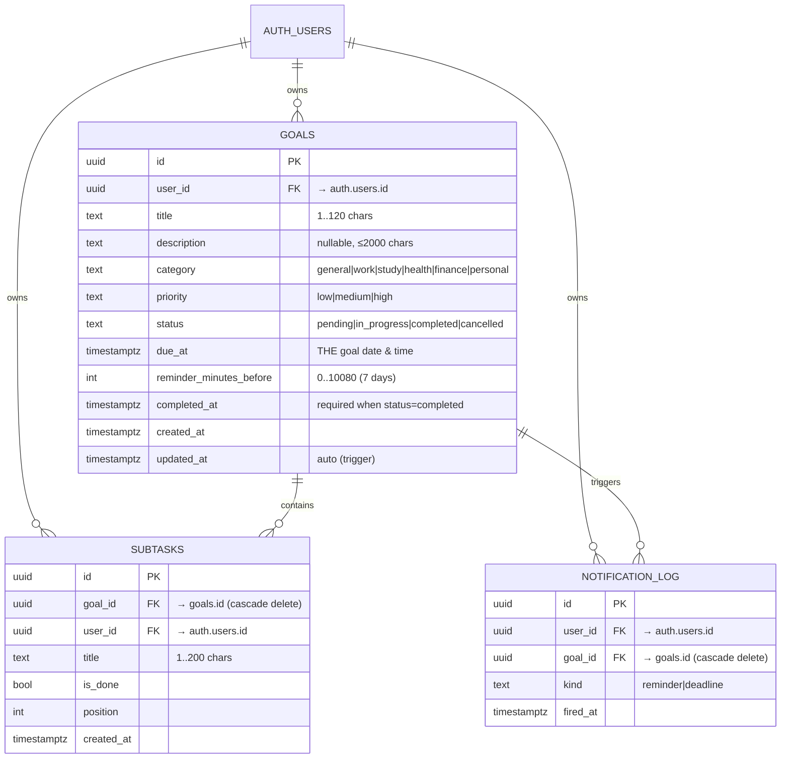

# Database Schema — Momentum

Self-hosted Supabase (PostgreSQL 17) · Source of truth: [`supabase/migrations/20261027000001_init.sql`](../supabase/migrations/20261027000001_init.sql)

## ERD



## Tables & relationships

### `goals`
The core entity: a commitment with an **exact deadline** (`due_at`, `timestamptz`).
`reminder_minutes_before` defines the alarm window — the alarm engine fires a
*reminder* when `now >= due_at − reminder_minutes_before`, and a *deadline* alarm
when `now >= due_at`. Constraints:

- `title` 1–120 chars; `description` ≤ 2000 chars
- enums enforced by `CHECK` (category, priority, status)
- `reminder_minutes_before` between 0 (no reminder) and 10080 (7 days)
- **`completed_has_timestamp`**: a goal marked `completed` must have `completed_at`
- `updated_at` maintained by the `set_updated_at()` trigger

Indexes: `(user_id, due_at)` for the dashboard ordering, `(user_id, status)` for filters.

### `subtasks`
Optional checklist inside a goal. Deleting a goal cascades to its subtasks.
A subtask can only be created for a goal the same user owns (RLS `EXISTS` check).

### `notification_log`
Append-only record of fired alarms (`kind` = `reminder` or `deadline`, `fired_at`).
The `GET /api/goals/due` endpoint excludes goals that already have a log entry,
so **each alarm rings exactly once**, even across tabs or devices.

## Access controls (RLS)

Every table has **Row Level Security enabled** with owner-only policies:

| Policy | Table | Rule |
|--------|-------|------|
| `goals_select_own` / `insert` / `update` / `delete` | goals | `auth.uid() = user_id` |
| `subtasks_*_own` | subtasks | `auth.uid() = user_id` (+ insert requires owning the parent goal) |
| `notification_log_select/insert/delete_own` | notification_log | `auth.uid() = user_id` |

Consequences:

- The browser only ever receives the **anon key**; without a valid session the
  policies return zero rows.
- The `service_role` key (bypasses RLS) is never shipped to the client and is
  not committed to the repo.
- Even if an attacker forged a request with their own valid session, they could
  only read/write rows whose `user_id` equals their own uid.

## Verifying locally

```bash
npx supabase studio   # open Studio at http://127.0.0.1:55323
# Table Editor -> goals / subtasks / notification_log
```
